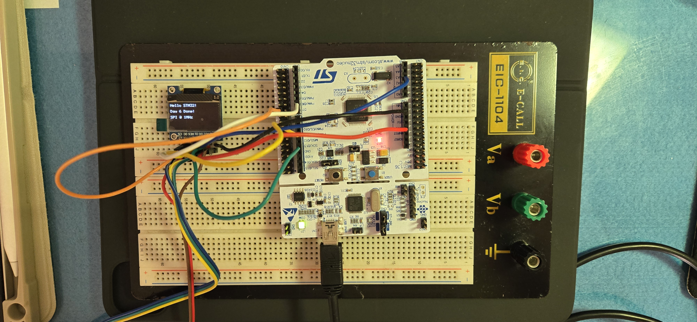

# Day 6：SPI 周邊驅動 — SSD1306 OLED 文字顯示

## 📊 實作總覽

| 項目 | 內容 |
| --- | --- |
| 通訊介面 | SPI（4-wire，多一條獨立 D/C 腳位區分指令/資料） |
| 顯示晶片 | SSD1306（128×64，單色 OLED） |
| 傳輸速率 | 設定 1 MHz（杜邦線飛線，保守設定；datasheet 上限 10 MHz），實測 SCLK 705.9 kHz（見 [Phase 2-01](../Phase2_AttitudeSensing/01_SPI_Optimization/01_README.md)） |
| 實作功能 | 硬體重置、初始化序列、清屏、5×7 點陣字型繪製、字串輸出 |
| 遇到的問題 | 字型陣列查表越界，顯示不支援的字元時讀到陣列外的記憶體 |

**結論**：不靠現成函式庫，照 SSD1306 datasheet 從零寫出完整驅動：初始化序列、framebuffer paging、5×7 字型輸出。

## 🔍 根因分析：字型陣列越界

`font5x7[][5]` 只定義 `0x20`（空白）到 `0x7A`（`'z'`）共 91 個字元，用 `font5x7[c - 0x20]` 直接查表：

```cpp
void oled_draw_char(char c, uint8_t col, uint8_t page) {
    if (c < 0x20 || c > 0x7A) c = ' ';  // 邊界檢查：0x7B（'{'）以上就超出字型表範圍
    ...
    const uint8_t* glyph = font5x7[c - 0x20];
    ...
}
```

- **問題**：一開始沒有上界檢查。印出 `'{'`（`0x7B`）這類字元時，索引落在陣列外，讀到其他變數的資料，OLED 顯示亂碼；程式不會當機也不會報錯，所以很難發現
- **修法**：查表前先把字元夾在 `[0x20, 0x7A]`，超出範圍一律當空白

## 📁 檔案結構

```
Day06_OLED_SPI/
├── main.cpp
├── Core/
│   ├── Inc/
│   │   └── oled_ssd1306.h
│   └── Src/
│       └── oled_ssd1306.cpp
```

## 🛠 編譯與燒錄

在專案根目錄 `STM32_F446RE_Learning/` 下用 **PowerShell** 執行 [`build-day-from-portfolio.ps1`](../build-day-from-portfolio.ps1)，編譯完會自動燒錄到板子：

```powershell
powershell -ExecutionPolicy Bypass -File .\build-day-from-portfolio.ps1 -Day Day06_OLED_SPI
```

## 🖥 顯示畫面

實機接線與 OLED 實際輸出（128×64，三行文字，跟 `main.cpp` 內容逐字對應）：



## 💡 學到的重點

| 重點 | 說明 |
| --- | --- |
| 從 datasheet 寫出驅動 | 照規定順序初始化：關閉顯示 → 定址模式 → 開 Charge Pump → 對比度 → 開啟顯示 |
| SPI + D/C 腳位 | 同一條 MOSI 靠 D/C 區分指令與像素資料；只寫不讀，MISO 接 `NC` |
| Framebuffer Paging | 128×64 分成 8 個 page，一個 byte 控制垂直 8 個像素；5×7 字型逐欄寫入 GDDRAM |
| 查表前先做邊界檢查 | 越界讀取不會報錯、只會顯示亂碼，所以要在入口就夾住合法範圍 |

## 🔗 與其他 Day / 專案的連結

- **← Day 4**：沿用模組化拆法，`main.cpp` 只呼叫 `oled_init()`、`oled_draw_string()` 等 API
- **→ [Phase 2-01](../Phase2_AttitudeSensing/01_SPI_Optimization/01_README.md)**：沿用這份 driver 測試 1/4/8/16 MHz 的訊號正確性
- **→ Phase 2-04**：用這顆 OLED 顯示感測器數值
